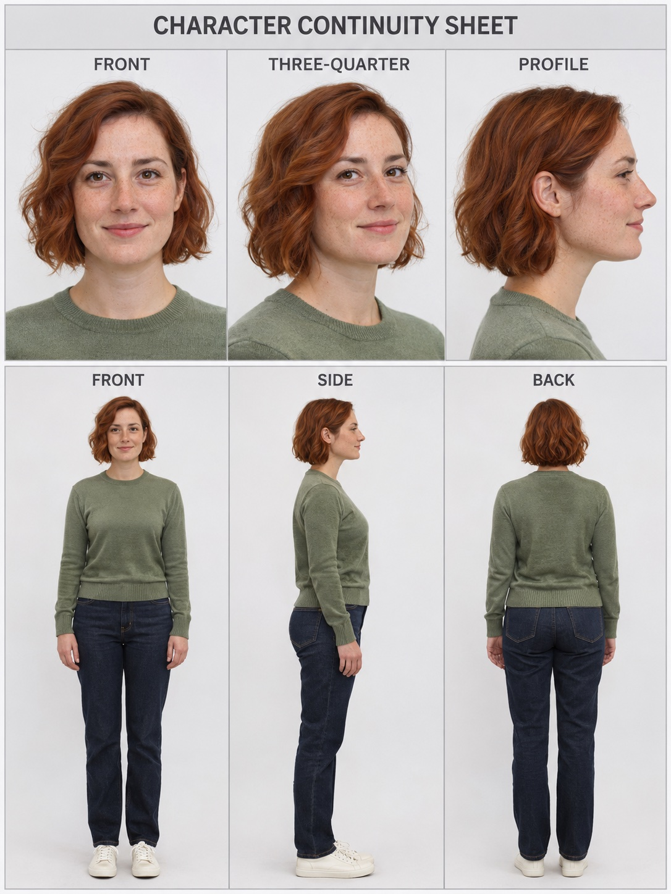

# Character Continuity Sheet

Hey — this is the prompt behind the sheet in my Instagram post.

You know the problem: you generate a person with AI, and every new image gives you a slightly different face. This prompt fixes that. It gives you one sheet with 6 views of the same person, and from then on you use that sheet as your reference for every image and video.

Here's the sheet it makes:



## How I use it

1. Open your AI image tool — I use it in ChatGPT and Gemini, it works in both.
2. Upload your photos of the person. Put your best, clearest face photo first, and add a full-body photo if you have one.
3. Copy the prompt below and paste it in, word for word.
4. Save the sheet it gives you back. That's your master reference now — use it for everything you make with that person.

## The full prompt

Tap the copy button at the top right of this box, and paste it exactly as it is:

```text
Using my uploaded photos, produce a high-resolution, photorealistic character continuity sheet for AI image and video creation. The person’s recognizable identity must remain the highest priority throughout.

KEEP THE PERSON’S LIKENESS INTACT

Every view must clearly represent the same individual shown in my references. Maintain their apparent age, facial structure, eye shape and spacing, eyebrows, nose, lips, jawline, ears, complexion, hairline, hairstyle, and distinguishing features.

Preserve natural facial asymmetry and authentic skin texture. Do not beautify the face, smooth the skin, slim the face or body, alter their age, or exaggerate features. Whenever a styling or composition choice affects resemblance, favor accurate identity and recognizable body proportions.

FOLLOW THIS REFERENCE ORDER

* Treat the first photo as the main guide for facial identity, hairstyle, and apparent age.
* Use the full-body photo to establish body proportions, outfit, shoes, and accessories.
* Refer to the remaining photos of the same person for additional facial and body angles.
* If an example sheet is included, borrow only its layout ideas. Do not transfer the example person’s appearance to my subject.
* Where a detail is not visible, use a simple, consistent interpretation. Do not introduce tattoos, jewelry, logos, or distinctive markings that are absent from the references.

ARRANGE SIX VIEWS ON ONE SHEET

Use a vertical 3:4 canvas, divided into three columns and two rows. Allocate approximately 40% of the usable height to the upper row and 60% to the lower row.

Upper row: close head-and-shoulders portraits

* FRONT: Face directly toward the camera, with eyes looking into the lens.
* THREE-QUARTER: Turn the face approximately 45 degrees.
* PROFILE: Show a true side profile.

Keep the same relaxed, natural expression in all three portraits. Faces should be unobstructed and large enough to examine their features clearly.

Lower row: complete standing views

* FRONT: Stand naturally, facing the camera.
* SIDE: Stand naturally with the body in a true side view.
* BACK: Stand naturally, facing completely away from the camera.

Match the scale of all three full-body figures, keeping their entire heads and feet inside the frame. Let clothing folds and body silhouettes change naturally with the viewing angle.

MAINTAIN A CONSISTENT STUDIO APPEARANCE

Make every panel look like a photograph taken during the same studio session.

Use soft, evenly distributed lighting, a neutral white-to-light-gray background, realistic colors, and gentle contact shadows under the feet. Avoid dramatic lighting and distortion from wide-angle lenses.

Keep clothing, garment details, accessories, hair, body proportions, and footwear consistent across all views. Anatomy and hands must look natural and believable.

KEEP THE PRESENTATION CLEAN

Use balanced spacing, thin light-gray separators, and small, legible view labels. Give clear facial detail priority over decorative elements.

The only text on the sheet should be:

CHARACTER CONTINUITY SHEET

Upper labels: FRONT · THREE-QUARTER · PROFILE
Lower labels: FRONT · SIDE · BACK

Generate and return the completed reference-sheet image directly.
```

Rather have it plain, with no formatting? Here you go: [prompt.txt](prompt.txt)

## One honest note

This keeps the face *much* more consistent, but AI still isn't perfect. Check the sheet it gives you before you build anything on it — if a face looks off, just generate it again.

Want more like this? I post tested prompts on Instagram: [@raised_by_the_algorithms](https://www.instagram.com/raised_by_the_algorithms/)
